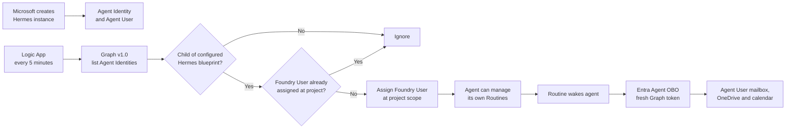

# Automatic Foundry access for new Hermes Agent Identities

## Status

Validated end to end on 2026-08-27. A newly provisioned Microsoft 365 Hermes instance was discovered
automatically, received **Foundry User** at the configured Foundry project scope, and then created a
working Foundry Routine. No role was manually assigned to that Agent Identity.

This is a tenant administrator bootstrap implemented with Azure CLI and an ARM template. The main
`setup.sh`/`azd provision` flow invokes it automatically; it can also be run independently. The
administrator installs it once for a Hermes blueprint and Foundry project, and the deployed
workflow handles later Agent Identities.

## Why it is required

Two unrelated authorization systems participate in scheduled work:

1. Creating, listing, updating, or deleting a Foundry Routine is a Foundry project data-plane
   operation. Microsoft currently documents **Foundry User** or higher at project scope as a
   prerequisite.
2. When the Routine runs, Hermes uses Entra Agent OBO to select the instance's Agent Identity and
   paired Agent User and obtain a fresh Microsoft Graph token. This authorizes the agent's own mail,
   calendar, OneDrive, and other Microsoft 365 operations.

Agent OBO solves the second boundary, not the first. Azure RBAC also does not inherit from an Agent
Identity Blueprint to its child Agent Identities. A newly provisioned Agent Identity can therefore
use its Microsoft 365 identity while still receiving HTTP 403 from the Foundry Routines API.

## Architecture



The automation does not create the Microsoft 365 instance. Microsoft continues to create and bind
the Agent Identity, Agent User, mailbox, OneDrive, Teams identity, owner, and hosted-agent instance.
The workflow supplies only the missing Azure project role after the Agent Identity exists.

## What the installer creates

`scripts/install-agent-rbac-automation.sh` performs these operations:

1. Verifies the selected Azure subscription, Foundry project, and required inputs.
2. Registers the `Microsoft.Logic` resource provider if the subscription has never used Logic Apps.
3. Deploys `infra/agent-rbac-automation.json` as a Consumption Logic App with a system-assigned
   managed identity.
4. Grants that managed identity the Microsoft Graph application permission
   `AgentIdentity.Read.All` so it can list Agent Identities through the supported Graph v1.0 API.
5. Assigns **Role Based Access Control Administrator** to the managed identity at only the selected
   Foundry project scope.
6. Adds an Azure ABAC condition to that assignment. The workflow may create or remove only
   **Foundry User** assignments and only for `ServicePrincipal` targets. It cannot assign Owner,
   Contributor, or another Azure role.
7. Runs every five minutes by default, filters Graph results by the configured
   `agentIdentityBlueprintId`, and assigns Foundry User only when missing.

The workflow has no client secret, certificate, refresh token, or stored administrator credential.
Azure manages its identity and token issuance.

## Administrator prerequisites

The administrator needs:

- Bash, Python 3, and Azure CLI (`az`). `azd` is needed only when this is installed as part of the
  complete `setup.sh` flow.
- Permission to deploy a Consumption Logic App in the selected resource group.
- `Microsoft.Authorization/roleAssignments/write` at the Foundry project or a parent scope, normally
  through Owner or Role Based Access Control Administrator during installation.
- Directory authority to grant the admin-consented Microsoft Graph application permission
  `AgentIdentity.Read.All` to the Logic App managed identity.
- The Azure subscription, resource group, Foundry account, Foundry project, and Agent Identity
  Blueprint application/client ID.

Sign in and select the intended subscription before installation:

```bash
az login --tenant <tenant-id>
az account set --subscription <subscription-id-or-name>
```

The blueprint client ID is visible on the Agent Identity Blueprint in Microsoft Entra. It can also
be read from the serving Hosted Agent version when the administrator knows the account, project,
and agent names:

```bash
BASE="https://<account>.services.ai.azure.com/api/projects/<project>"
VERSION=$(az rest --method GET --resource https://ai.azure.com \
  --url "$BASE/agents/<hosted-agent>?api-version=v1" \
  --query 'agent_endpoint.version_selector.version_selection_rules[0].agent_version' -o tsv)

az rest --method GET --resource https://ai.azure.com \
  --url "$BASE/agents/<hosted-agent>/versions/$VERSION?api-version=v1" \
  --query 'blueprint.client_id' -o tsv
```

## Install once

Run from the repository root:

```bash
./scripts/install-agent-rbac-automation.sh \
  --resource-group <resource-group> \
  --account <foundry-account> \
  --project <foundry-project> \
  --blueprint-client-id <blueprint-client-id>
```

Optional parameters:

- `--workflow-name <name>` changes the default `hermes-agent-foundry-role-sync` resource name.
- `--location <region>` overrides the resource group's Azure region.
- `--poll-minutes <1-60>` changes the default five-minute interval.
- `--include-existing` also reconciles Agent Identities created before installation. Without this
  explicit flag, existing identities are never modified.

The script is idempotent. Re-running it preserves the original creation-time cutoff and verifies
that the existing RBAC delegation still has the exact restrictive condition. It aborts rather than
silently accepting or replacing a broader delegation.

An initial Logic App run can return Graph 403 while the new application permission propagates.
Later scheduled runs retry automatically. In the validated deployment, the permission propagated
within several minutes.

## Verify

1. In Azure Portal, open the deployed Logic App and inspect **Runs history**. The latest run should
   show `Succeeded`.
2. Provision a new Hermes instance through Microsoft's Teams or Microsoft 365 admin experience.
3. Wait approximately 5–10 minutes for polling and Azure RBAC propagation.
4. Open the Foundry project in Azure Portal, select **Access control (IAM)**, and search for the new
   Agent Identity. It should have **Foundry User** at the project scope.
5. Ask the new agent to create a Routine with an explicit time and IANA time zone, then verify it
   appears through `list_routines` and executes.

The role is an Azure resource role on the Agent Identity service principal. It does not appear under
Microsoft Entra directory roles, so seeing zero roles on the Entra **Roles and administrators** page
is expected.

## Security boundary

- The Graph permission can read all Agent Identity objects in the tenant. Graph does not currently
  offer a blueprint-scoped application permission. The workflow itself filters to one exact
  `agentIdentityBlueprintId` before taking action.
- The Azure ABAC condition limits delegated assignment to the Foundry User role and
  `ServicePrincipal` targets at one Foundry project. Azure RBAC cannot express the Graph parent-child
  blueprint relationship in that condition.
- Anyone allowed to edit the Logic App can exercise its permissions. Restrict workflow write access
  to the tenant's trusted provisioning administrators and audit definition changes.
- The workflow hides Graph discovery and role-assignment request bodies from run-history output.
- The generated Foundry User assignments are normal Azure resources and remain independently
  visible and auditable under project IAM.

## Cost

At a five-minute interval, the workflow runs 8,640 times in a 30-day month. Consumption Logic Apps
include the first 4,000 built-in operations per Azure subscription and then charge per operation.
In the validated nine-identity POC, the estimated cost is approximately USD 2.50/month plus
negligible run-history storage. Each post-installation identity adds approximately USD 0.65/month at
the five-minute interval because its existing role is rechecked on every run.

Use `--poll-minutes 15` to reduce execution cost by approximately two thirds when a 15-minute
provisioning delay is acceptable. A supported Microsoft instance-created event would remove the
need for polling, but no such event is used by this implementation.

## Remove the automation

```bash
./scripts/remove-agent-rbac-automation.sh \
  --resource-group <resource-group> \
  --account <foundry-account> \
  --project <foundry-project>
```

Removal deletes the Logic App and its constrained project delegation. It deliberately leaves
Foundry User assignments already created for Agent Identities, avoiding a surprise outage for
existing agents. Removing those assignments is a separate explicit administrator decision.

## Microsoft references

- [Automate agents with routines](https://learn.microsoft.com/en-us/azure/foundry/agents/how-to/use-routines)
- [List Agent Identities with Microsoft Graph](https://learn.microsoft.com/en-us/graph/api/agentidentity-list?view=graph-rest-1.0)
- [Agent Identity resource](https://learn.microsoft.com/en-us/graph/api/resources/agentidentity?view=graph-rest-1.0)
- [Delegate Azure role assignment management with conditions](https://learn.microsoft.com/en-us/azure/role-based-access-control/delegate-role-assignments-overview)
- [Authenticate Logic Apps with managed identities](https://learn.microsoft.com/en-us/azure/logic-apps/authenticate-with-managed-identity)
- [Logic Apps metering and billing](https://learn.microsoft.com/en-us/azure/logic-apps/logic-apps-pricing)
